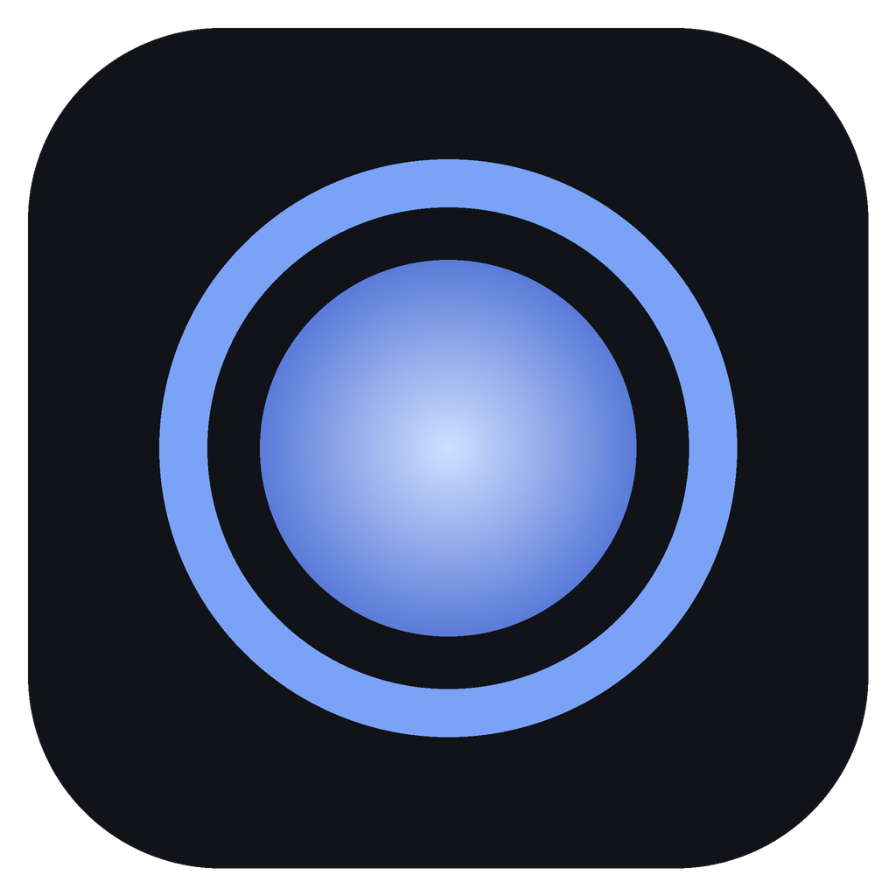

# Focus Protocol

A desktop app that walks you through a full deep-work session in four phases: reset, activate, work, wind down.


## Why

Most focus apps are just a timer. But how you *start* and *stop* working matters as much as the work block itself. Focus Protocol strings together a set of well-known productivity habits into one routine. You reset with a period of low stimulation, get your body going with a sensory kick, work in Pomodoro rounds with optional focus audio, then come down with something healthy instead of reaching for your phone.

Every time you open the app, it starts again at phase 1.

## The four phases

| Phase | What happens | The idea behind it |
|---|---|---|
| **1. Pre-loading** | Set up the session: a title, what *done* looks like, Pomodoro or Flowtime, your timings (with 25/5, 50/10, 52/17 and 90/20 presets), an optional if-then plan ("When the timer starts, I'll open the outline"), and a quick checklist (phone away, notifications off, water, tabs closed). Then 5, 10 or 15 quiet minutes (5 by default) with no phone, music or feeds. | Start without your attention already pulled elsewhere. A specific goal, an if-then plan and fewer interruptions are the best-supported ways to make starting easier. |
| **2. Activation** | Pick one: the built-in 2-minute sequence (5 physiological sighs to settle, a minute of jumping jacks to a drum beat, an optional cold-water splash), a 60-second all-out movement burst, your own hype song, or your own trigger. | Settle first, then a clear physical signal that it's time to work. |
| **3. Immersion** | A minimal timer you can pause. **Pomodoro** counts down, and every 4th break is a long one. **Flowtime** counts up until you take a break, and the break is a fifth of the time you worked; after 90 minutes without one, it gently suggests a break. Rest mode shows a stretch list, guided box breathing or cyclic sighing. A *parking lot* box lets you jot stray thoughts down without leaving your work. Optional binaural beats, isochronic tones or brown noise. | Distraction-free work in rounds, with breaks that actually rest you. |
| **4. Exit protocol** | A summary of your session, then a short **shutdown ritual**: decide what happens to each parked thought (done, to your to-do list, keep for next session, or drop), write the very next action for next time, rate your focus, and note what helped and what distracted you most. After that, a searchable checklist of wind-down activities: walk, meditate, 20 pushups, journal, NSDR, and more. | Close the loop so work stops nagging you, then come down gradually rather than jumping straight to cheap stimulation. |

Every phase except the last has a **Skip →** button. The **History** and **⚙ Settings** buttons are always in the top right.

> These are popular productivity practices, not medical advice. The evidence is strongest for the planning parts (goal, if-then plan, parking lot, next step, notifications off). Evidence for binaural beats is mixed, there is none for 40 Hz, and noise mostly helps people with ADHD traits, so treat the sounds as optional.

## Features

- Four-phase flow that restarts at phase 1 on every launch
- Pomodoro timer with your own work, rest and long-break lengths, presets, pause and resume (or press <kbd>Space</kbd>), a progress bar, and automatic rounds (every 4th break is long)
- History: focus time today and over the last 7 days, a bar chart per day, how many of the last 7 days you focused (no streak to break: rest days are part of the routine), your self-rated focus, and your recent sessions
- Mini timer (desktop app): shrinks to a small window in the corner that stays on top while you work in other apps
- Flowtime mode: the timer counts up, you decide when to break, and the break scales with how long you worked
- Session goal, an optional if-then plan, and a "start here next time" note: what you write at Exit is shown when your next session starts
- A gentle nudge after 90 minutes of Flowtime without a break
- Distraction parking lot during work; at the shutdown ritual you decide what happens to each thought
- Quick reflection (focus 1–5, what helped, biggest distraction), shown at the start of your next session
- Four activation options, including a 60-second movement burst and a link to your own hype song
- Guided box breathing (4-4-4-4) or cyclic sighing as alternatives to stretching during breaks
- Binaural beats or isochronic tones at 10 Hz (alpha), 15 Hz (beta) or 40 Hz (gamma), plus brown noise, all generated live in the app with no audio files
- A desktop notification when a timer ends while the app is in the background
- Keeps your screen awake during work rounds
- A built-in activation sequence with a breathing guide, a drum beat and a colour shift (deliberately no strobing)
- A session summary and a searchable exit-protocol checklist
- Settings: choose which speakers or headphones the sound plays through, and edit the exit-protocol and stretch lists to make them your own
- Your title, goal, timings, sound, volume, lists, notes and history are remembered between launches
- Calm by design: screens fade in and out, breaks switch to their own colour, and timer settings fold away until you need them
- Desktop app updates itself (Windows installer and Linux); the web version can be installed and works offline

## Quick start

### Use the app

**In your browser, no install:** open **https://nathanlaborada.github.io/focus-protocol/**. Your settings are saved in that browser. Keep the tab open during a session, since browsers can slow timers in background tabs; the desktop app doesn't have that limit. In Chrome or Edge you can also click the install icon in the address bar to give it its own window. After your first visit it opens offline too.

**Desktop app:** download the file for your system from the [Releases](../../releases) page.

**Windows**, pick one:

- `Focus-Protocol-Setup-<version>.exe` installs the app, adds a Start menu entry, starts faster, and updates itself: new versions download in the background and install when you close the app.
- `Focus-Protocol-Portable-<version>.exe` needs no install. Double-click it and it runs as-is.

Windows SmartScreen may say *"Windows protected your PC"*, because the app isn't code-signed. Click **More info → Run anyway**.

**macOS:** open `Focus-Protocol-<version>.dmg` and drag the app into Applications. It isn't signed by Apple, so the first time, right-click the app and choose **Open**. On newer macOS versions, if that doesn't offer an Open button, go to **System Settings → Privacy & Security** and click **Open Anyway**.

**Linux:** download `Focus-Protocol-<version>.AppImage`, make it executable (`chmod +x Focus-Protocol-*.AppImage`), and run it. It updates itself like the Windows installer.

### Run from source

Requires [Node.js](https://nodejs.org) 18 or newer.

```bash
git clone https://github.com/NathanLaborada/focus-protocol.git
cd focus-protocol
npm install
npm start
```

### Build the .exe yourself

```bash
npm run dist
```

This writes the Windows installer and portable .exe to `dist/`, using the version from `package.json`. On a Mac or Linux machine, `npx electron-builder` builds for that system instead.

### Releasing

Releases are built automatically by GitHub Actions (`.github/workflows/release.yml`) for Windows, macOS and Linux.

1. Bump `version` in `package.json` and commit.
2. Tag and push: `git tag v1.x.0`, then `git push --tags`.
3. The workflow builds on all three systems and attaches the files to the GitHub Release for that tag, including the `latest*.yml` files the auto-updater reads.

To test the builds without releasing anything, run the workflow by hand: **Actions → Release → Run workflow**, or `gh workflow run release.yml`. The files appear as downloads on that run.

## How it works

The whole app is three plain files (`index.html`, `style.css`, `app.js`) with no framework, wrapped in Electron by `main.js`. The same files are the web version on GitHub Pages.

- **Timers** count down to a fixed end time rather than counting ticks, so they stay accurate. Electron's background throttling is turned off, so timers keep running while the window is minimised.
- **Audio** comes from the browser's built-in audio engine (the Web Audio API):
  - *Binaural:* a 200 Hz tone in the left ear and a 215 Hz (or 240 Hz) tone in the right. Your brain hears the 15 Hz (or 40 Hz) difference as a beat. This needs headphones.
  - *Isochronic:* one 200 Hz tone switched on and off 10, 15 or 40 times per second by a square wave. It works on speakers.
  - *Brown noise:* 10 seconds of random noise made when you first pick it, then looped. Its end is matched to its start so there's no click at the loop point.
  - Alarms, the chime and the activation drum are short tones made the same way.
  - The output device is switched with `AudioContext.setSinkId`, so alarms and beats both follow your choice.
- **Notifications** use the standard web Notification API. They only appear when the app isn't the active window, since the alarm already covers that case.
- **Keeping the screen awake** uses the Screen Wake Lock API during Immersion, and the lock is taken again if you minimise and come back.
- **Settings and history** are saved in the app's local storage, on your device only, and never uploaded. The only thing the desktop app sends is its update check to GitHub Releases at launch.
- **History** stores one small entry per session (when, title, minutes, rounds, focus rating). The stats are worked out from those entries each time you open it.
- **Mini timer:** `preload.js` gives the page one function, which asks `main.js` to shrink the window to the corner and keep it on top. Expanding puts it back where it was.
- **Updates** use `electron-updater`. At launch, the installed app checks the latest GitHub Release, downloads a newer version in the background and installs it when you quit. The portable .exe and the Mac app skip this.
- **Offline web version:** a small service worker (`sw.js`) keeps a copy of the app files. It always tries the network first, so you get new versions straight away, and uses the copy only when you're offline. `manifest.webmanifest` makes it installable.

### Developing

Because the app is plain HTML, you can run it in a browser with any static server. Adding `?speed=60` to the URL makes every countdown 60× faster for testing:

```bash
python -m http.server 8765
# then open http://localhost:8765/?speed=60
```

## Tech stack

HTML, CSS, vanilla JavaScript, the Web Audio API, Electron, and electron-builder.

## Known limitations

- The app isn't code-signed, so Windows SmartScreen and macOS both warn on first launch. For the same reason the Mac app can't update itself: download new versions from Releases.
- History is kept separately in each browser and in the desktop app; they don't sync.
- In a regular browser, the output-device list may only show "System default" until the site is given microphone access. The desktop app lists every device.

## License

MIT. See [LICENSE](LICENSE).
